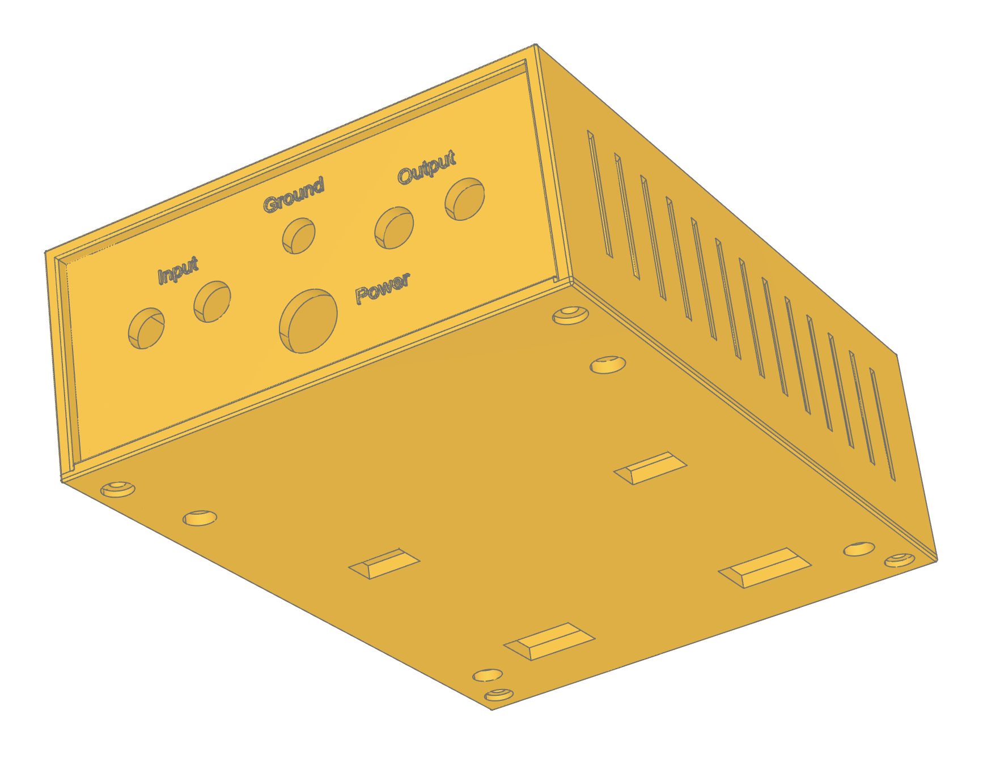
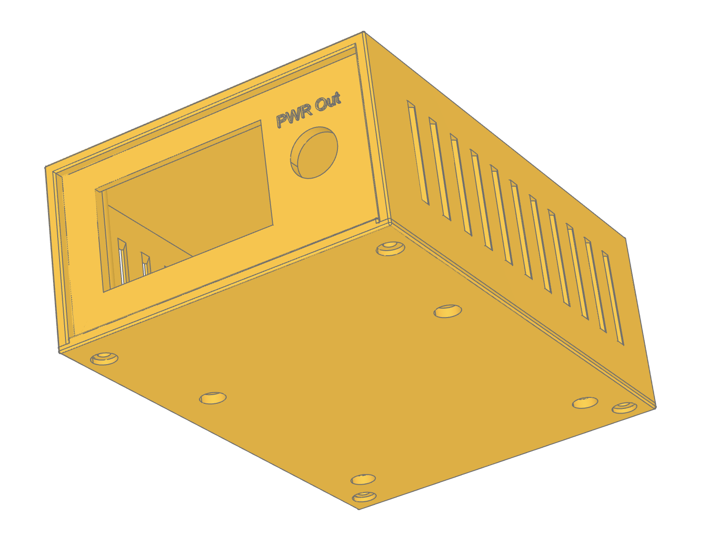
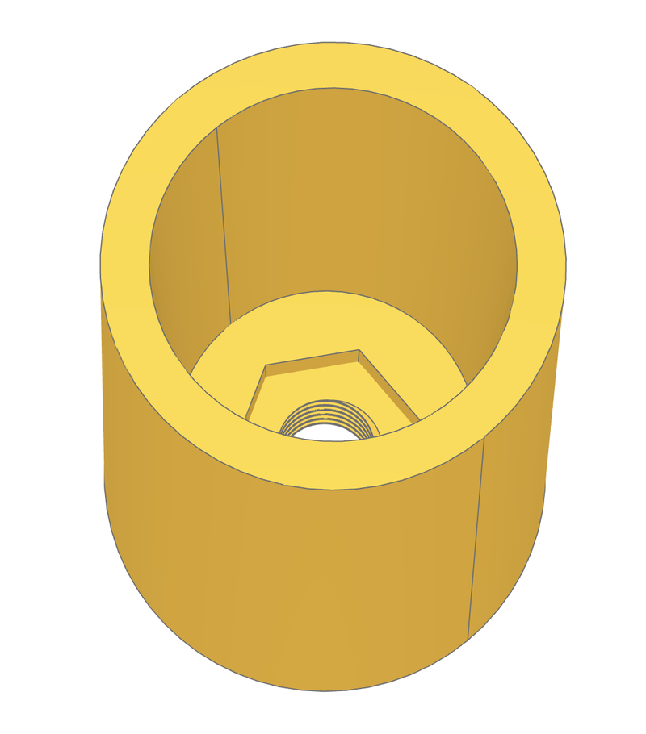
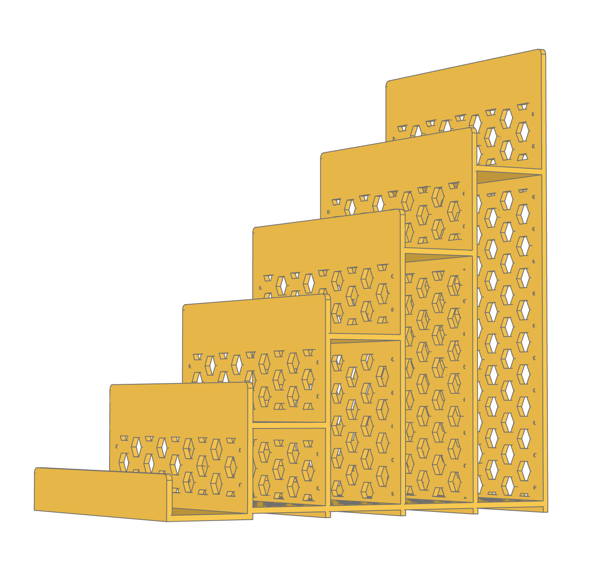
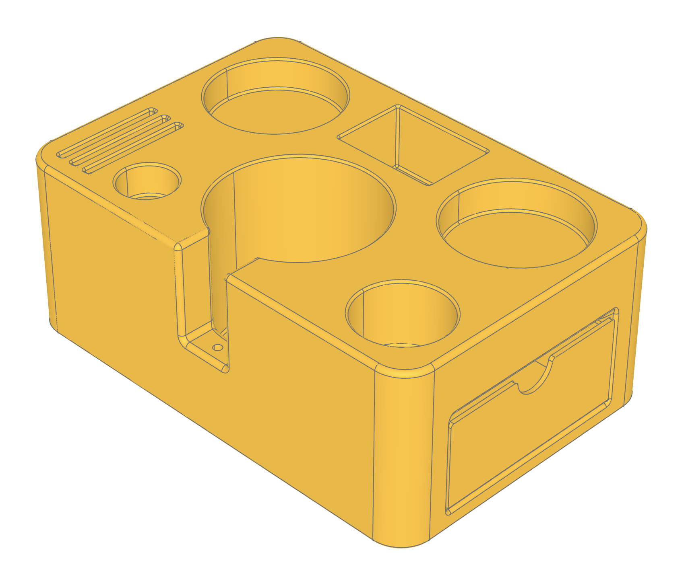
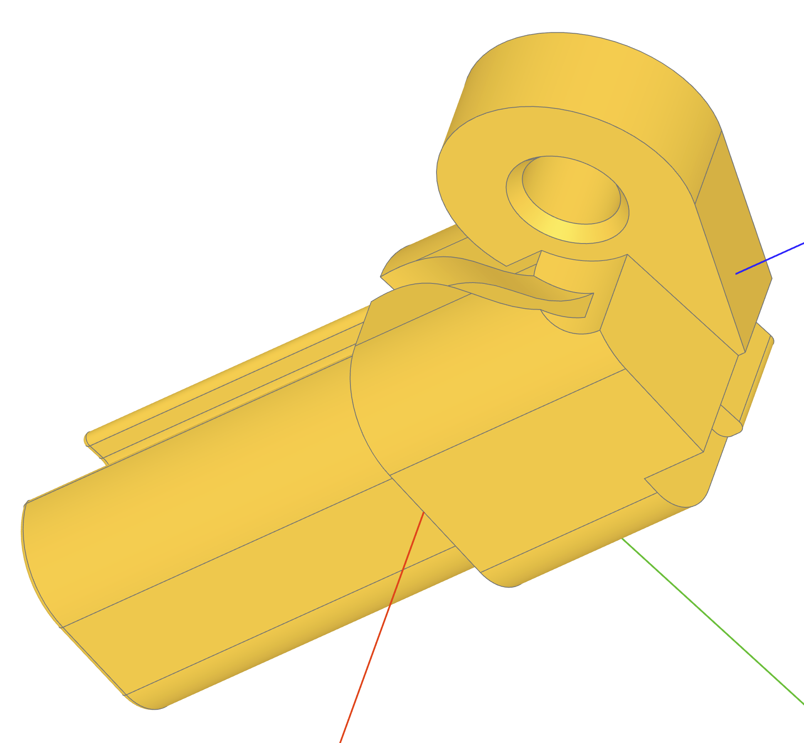
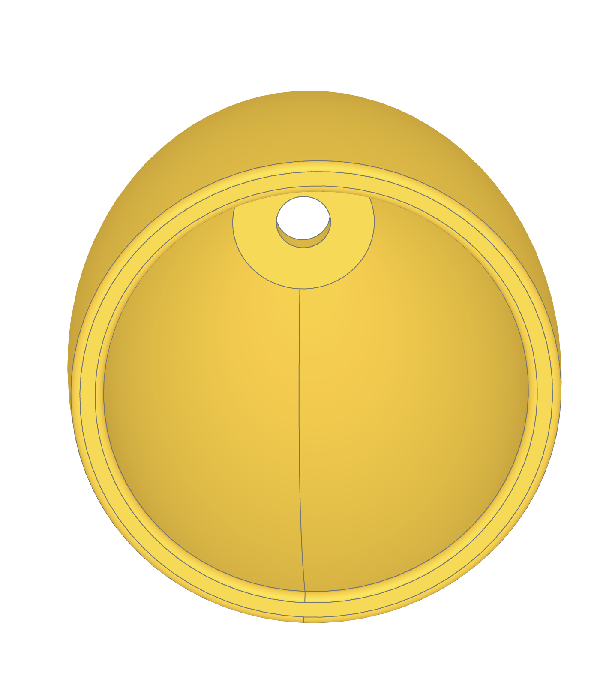
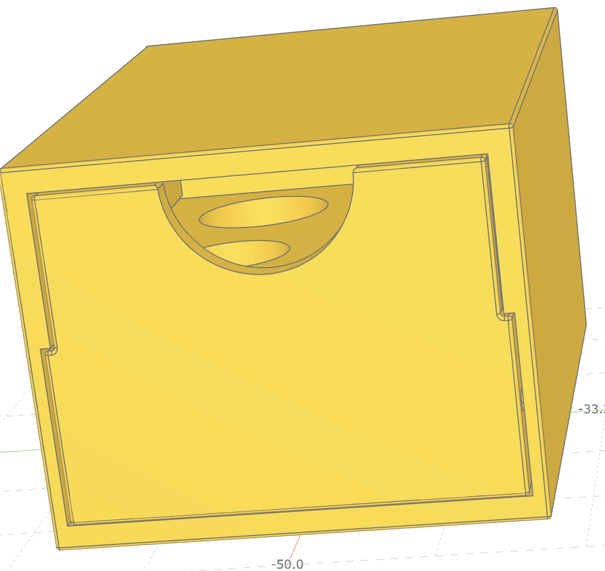
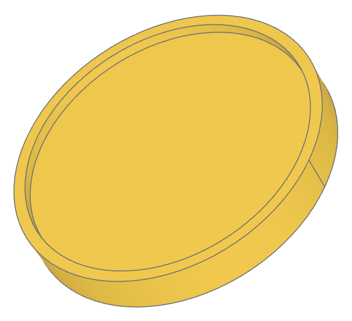
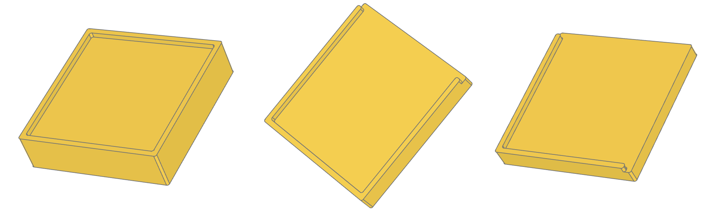

# CadQuery Designs Aimed for 3D-Printing

## Requirements
Create the conda environment with:

```sh
conda env create -f environment.yml
conda activate cadquery
```

I use VSCode + OCP CAD Viewer plugin. `CQ-editor` should work as well, but it is not part of the default environment because it currently requires the separate `cadquery` conda channel.

## Static Analysis
Install the local checks with:

```sh
pre-commit install
```

Run the full local suite with:

```sh
pre-commit run --all-files
```

The configured checks are basedpyright, Ruff, vulture, and small generic pre-commit hygiene checks for YAML, trailing whitespace, and final newlines. GitHub Actions runs the same pre-commit suite on push and pull request.

## cq_utils.py
Just a convenient utility module to share code snippets across the designs

## honeycomb.py
Utility module for applying honeycomb infill pattern to a given wall

## phono-preamp-psu.py
DIY phono-preamp and separate PSU cases.




## cone-column.py
Two hollow cone columns, one with a built-in ISO-thread and the other with a recess for a nut. I use these as limiters on my roller shutters.



## step-display-stand.py
Step display stand generator with various parameters available to configure



## tampering-station.py
Home baristas' best friend, a tampering station with some additional slots to store tools and accessories like leveler,
tamper, screens, porta filters, etc.



## ikea-kvartal-hook-adapter.py
IKEA Kvartal (a curtain hanging system) is discontinued since 2016, but it was a high-quality product and I don't want simply throw it out. So here is a hook adapter for Kvartal's gliders.

## mb-a205-windshield-lug.py
Two lugs for Mercedes-Benz wind shield (A2058680009), which is for A205 cabrio.
There are several different types of plastic lugs in this wind shield, but you won't confuse them visually.



## bell-shaped-handle.py
Bell-shaped hanging handle it's a thing you can put a lace through its top hole, tie a knot inside the handle and you have it hanging.



## wrench-bits-holder.py
Parametrized holder for cylindrical wrench bits with individual pocket depths and a sliding drawer.



## round-furniture-leg-spacer.py
Round spacer sized by the furniture-leg diameter inside its raised retaining rim. Its floor-facing side is flat.



## square-furniture-leg-spacer.py
Square spacer sized by the furniture-leg area inside its raised retaining rim. It has a flat floor face, rounded vertical edges, and can omit one edge for wall placement or two adjacent edges for corner placement.


